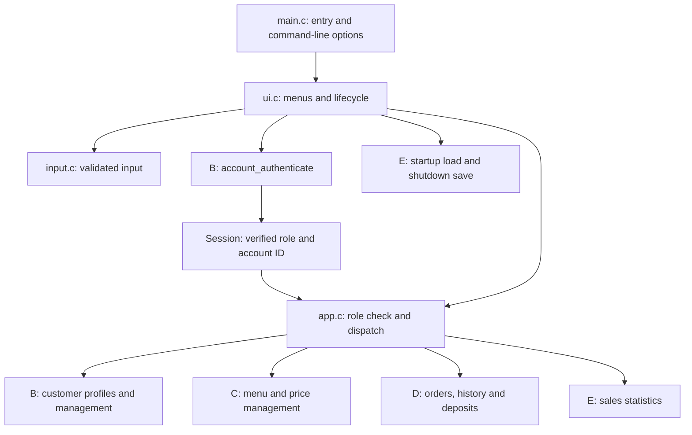

# Member A — architecture and application flow

## Structure

`main.c` handles help/version and returns the application's exit code. `ui.c` owns the session and
iterates between the public menu and the appropriate role menu. `app.c` validates the role before
calling a module; customer operations receive the verified account number rather than a newly
entered target number. `input.c` supplies reusable, bounded reads and strict value parsers.
B–E implement the actual module operations in their own source files.

## Login and navigation

The initial session is `ROLE_NONE/0`. The public menu offers customer login, registration, manager
login and exit. Login reads an account number and password, then calls B's authentication function.
The requested role is an input to verification, not proof of permission. A accepts only a successful
result with a nonzero identity matching the requested account and role. All failure paths retain a
logged-out session. Logout clears both fields; menus use loops rather than recursive calls, allowing
repeated login/logout without accumulating stack frames.

## Dispatch

Six actions belong to customers and six belong to managers. Each dispatch first checks that the
session is valid and its role matches the requested action. Invalid or forbidden requests return
without calling a business function. Business errors and cancellation return to the current menu
with a readable status message. The business functions retain responsibility for their own data
validation, such as account activity, available balance and valid menu options.

## Input

The reader consumes a full line even after detecting excessive length or unsupported control bytes,
so residual input cannot silently become the next menu choice. Both LF and CRLF are supported.
EOF is distinct from a read error and is propagated to callers. Integer parsing checks the entire
string and bounds; currency parsing uses checked integer arithmetic and at most two decimal places.
A failed parse does not update its output argument. Bounds are chosen by the calling module.

## Storage lifecycle

Startup invokes E's load function. I/O or data corruption errors stop the program without a save.
A not-yet-implemented storage module is explicitly identified as such in the development build.
After a successful load, normal exit and EOF invoke save. Failed save offers retry or exit with an
unsaved-data warning and failure exit code. This lifecycle does not implement transaction atomicity;
D/E must persist each completed transaction consistently before reporting business success.

## Test separation and current limits

The normal executable links all `src/*.c`. The separate demo/test executable links A's real code to
`tests/demo_modules.c`, which supplies fake identities and traces calls without modifying business data.
There is no runtime switch that enables fake login in the normal executable. Storage fault injection
and malformed authentication results exist only in that test replacement. The results verify A's
framework, not the unfinished B–E business algorithms or real file durability.
